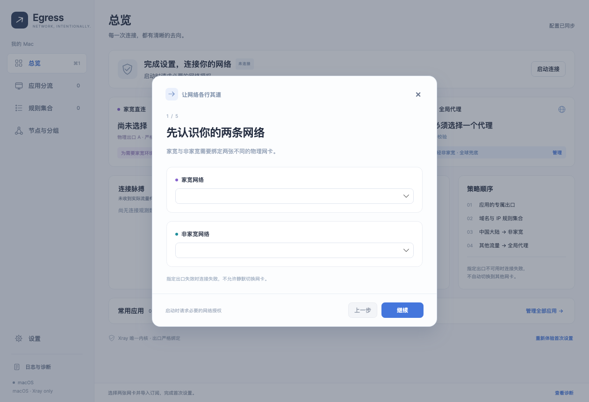
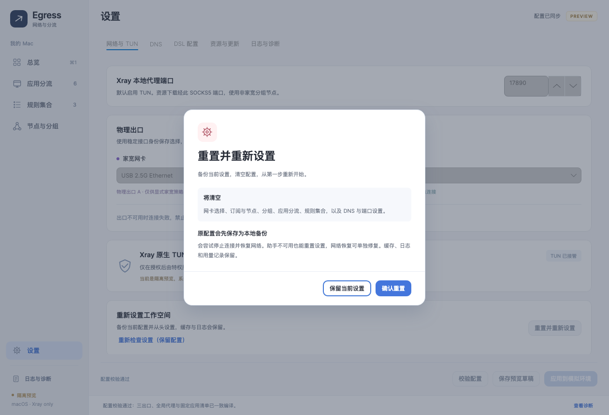
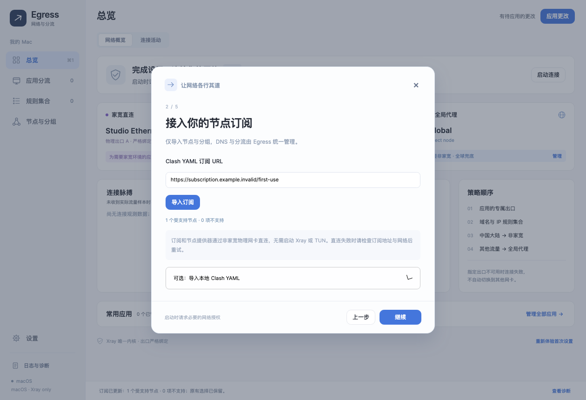
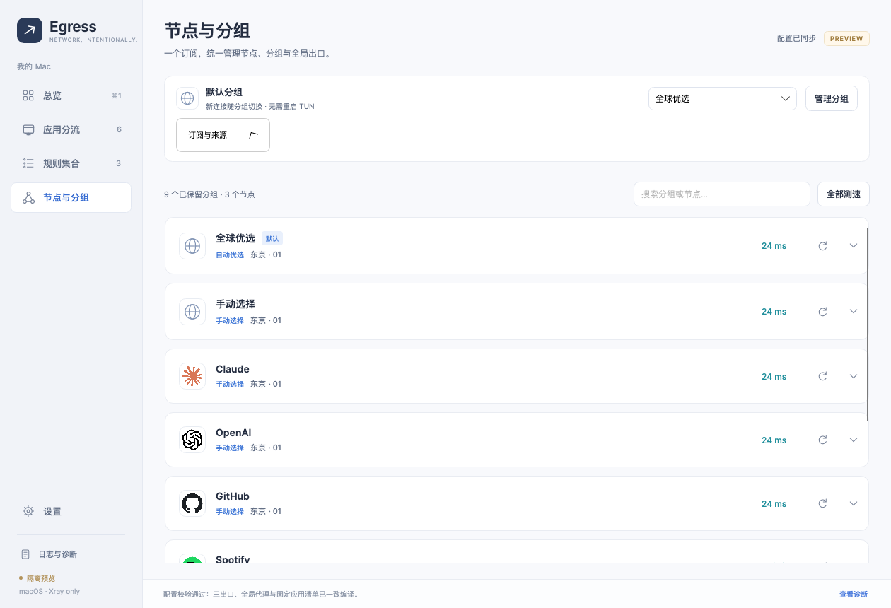
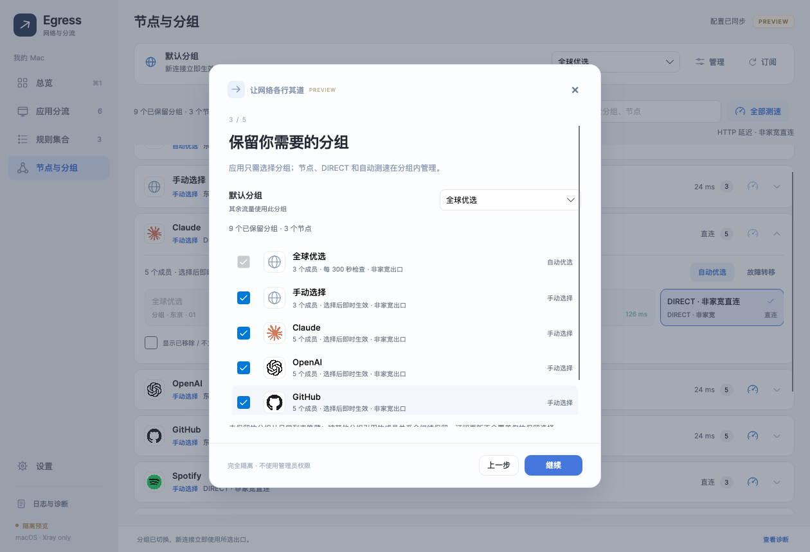
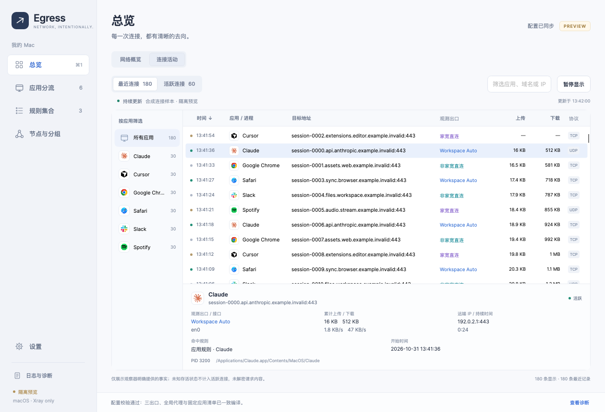
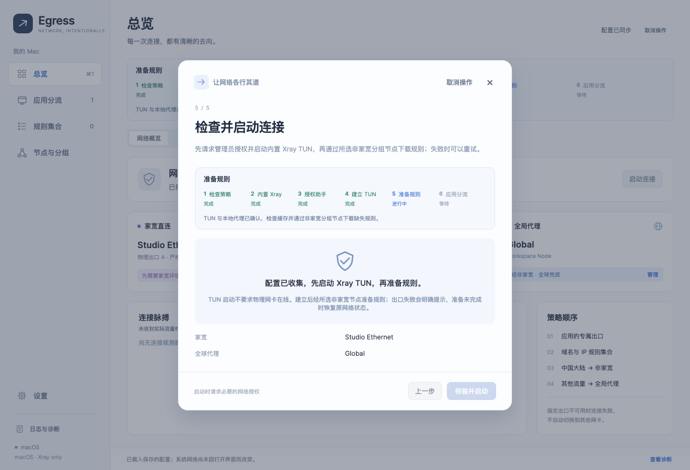
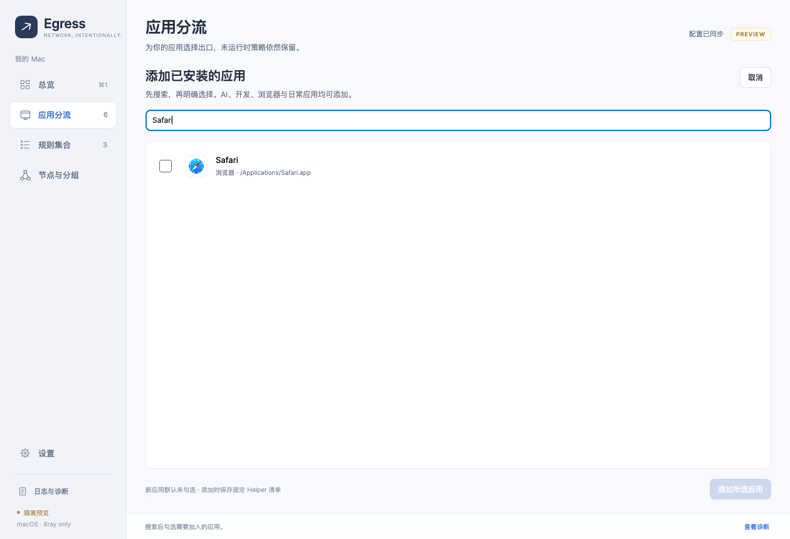

# Egress

Mac 优先的原生 Avalonia/.NET 客户端，以 Xray-core 为唯一网络内核。

应用、域名集合和 IP 集合共用三个出口：**家宽直连 / 非家宽直连 / 指定代理分组**。中国大陆默认非家宽，其他流量使用默认分组。分组可选择订阅节点、其他分组或 DIRECT（非家宽直连）；代理服务器严格经非家宽连接，绑定失败不换网卡。



## 运行

**双击打包后的 `Egress.app`，默认进入生产模式。** 打开界面会读取实际 App、网卡和保存的配置；不会仅因打开窗口而启动 TUN。

首次使用：选择两张不同网卡 → 检测家宽直连（Cloudflare / Google 必须返回 204）→ 直接导入 Clash HTTPS 订阅 → 勾选保留的分组并选择默认组 → 搜索并勾选应用 → 点击“应用并连接”。安装包自带固定版本 Xray；需要时出现 macOS 管理员授权框。首次检测只使用家宽网卡，失败不能下一步；日后启动 TUN 不额外要求物理网卡在线。先检查权限、TUN 和端口冲突并建立 TUN，再为自动分组测速和下载缺失规则，最后热更新完整分流，无需为这一步重新建立 TUN。网卡绑定在实际连接时执行，失败不换出口。停止、退出或准备失败时恢复连接前的网络状态。Rider 的生产运行和打包 `.app` 都进入完整 NativeAOT 客户端。

管理员密码只授权网络助手安装，Rider 和主界面保持普通用户权限，无需以管理员身份打开 Rider。失败时向导顶部直接显示错误，可点击“查看诊断”或“打开日志目录”；“日志目录”同时提供生命周期日志、逐项测速诊断和后台网络错误汇总，记录网卡、失败阶段与恢复结果；不记录订阅密码或请求内容。

**工作空间载入失败**时会提供重新载入、日志和重新设置入口，保留已读到的应用与配置；不会显示空白网卡设置或把失败状态标成已同步。向导固定步骤标题和底部操作，分组、应用列表独立滚动。

勾选应用后点击“继续”会扫描并保存固定清单；日常修改自动保存草稿，网络策略仍需应用。退出前等待正在进行的操作结束，再确认网络恢复；恢复失败保留窗口和重试入口。

**从头设置**：在“设置 → 网络与 TUN”或连接失败提示中点击“重置并重新设置”。确认后备份当前配置并清空网卡、订阅、分组、应用和规则选择。助手失联或版本不匹配也可以重置；网络恢复未确认时保留独立提示，可点击“修复助手并恢复网络”重新授权并恢复，不会自动连接。备份或保存失败才保留当前配置。旧生成配置、订阅/规则缓存和测速临时文件也会清理；后台生成文件在网络恢复确认后清理。独立备份、日志及用量记录保留。Rider Debug、Release 和打包客户端共用配置目录，新版本互斥运行，避免同时覆盖设置。



`--preview` 才进入隔离 UI；示例 URL 和示例测速只出现在预览中：

```sh
dotnet run --project src/EgressController.Desktop -- --preview
```

**订阅及其 provider 必须直连**：通过所选非家宽物理网卡获取，不使用系统代理，不要求 Xray、TUN、助手或本地 YAML。直连失败会明确报错并允许重试，已有节点和缓存保留。本地 YAML 导入只是可选入口。



规则资源优先使用已验证缓存。确需下载时，自动从默认分组中选择测速成功的非 DIRECT 节点，经内置 Xray 和非家宽网卡获取；没有可用代理时明确提示，不回退直连。无需单独配置下载节点。本地资源 SOCKS5 端口默认 `17890`，可在“设置 → 网络与 TUN”修改。SS 的 `obfs/http` 与 TFO 保留为 Xray 原生传输。

## 分组与连接活动

订阅导入后立即显示分组、图标与成员数量，首次设置可勾选需要保留的分组；应用与规则只需选择分组。未保留的组仍保存为嵌套依赖，不会破坏已有引用。只有节点的订阅会生成默认自动组。

“节点与分组”提供紧凑卡片、品牌图标、自适应成员网格、单组／全部 HTTP 延迟测速、自动优选和故障转移。测速通过非家宽物理出口，不依赖 TUN；结果逐批更新，可取消，期间仍能切换页面；解析、绑定、握手失败与超时分别显示。展开分组保持标题位置。已移除或不支持的成员默认隐藏，失效的当前选择会保留提示。新手动组采用订阅的 `default-selected` 或第一个声明成员；更新保留已有选择，缺失成员明确提示。每个组都可手动选择 DIRECT。测速地址、间隔和容差沿用配置，缺少地址时使用 `https://www.gstatic.com/generate_204`。

普通分组切换、自动优选和规则路由更新即时作用于新连接，保留现有 TUN；已有连接和历史出口不重标。节点传输、网卡或 DNS 等运行配置变化仍需要重新配置内核。自动测速失败保留当前出口，不改变保护状态。





总览中的“连接活动”提供应用筛选、搜索排序、最近/确认活跃、暂停显示及下方详情。列表更新保留选择、焦点和滚动位置。生产数据来自助手解析的实际 Xray 输出；访问记录无法证明连接仍存活，也不提供逐连接字节或完整 PID/路径，缺失字段显示未知，不读取请求内容。



连接期间显示检查策略、内置 Xray、授权助手、建立 TUN、准备规则、应用分流六个阶段；成功后收起进度面板。规则准备期间普通流量暂缓；端口占用、TUN 占用、出口连接失败、授权失败和接管超时都有明确提示与重试入口。



应用搜索支持名称、Bundle ID 和路径；Safari 的系统 Cryptex 应用链接会正确识别并去重。节点搜索支持名称、协议、服务器和所属分组。



## 开发验证与打包

需要 Apple Silicon macOS、.NET 10 SDK、Xcode Command Line Tools 和 CMake：

```sh
# 构建机获取固定发布归档；不会启动 Xray/TUN。
gh release download v26.10.29 --repo XTLS/Xray-core --pattern Xray-macos-arm64-v8a.zip --dir artifacts/core
python3 build/Verify-Mac.py --version 0.1.9
```

**开发测试只用 mock。** 该命令运行注入资源/进程/权限适配器的测试、纯 C ABI 探针、内置 Xray 命令行与模拟 Unix RPC 的规则资源回归检查、普通/紧凑 UI 截图与交互检查，再打包 GUI、助手及经归档/可执行文件双重 SHA-256 校验的 Xray。缺少内核时拒绝生成安装包。只执行包内显式 `--mock-smoke`，从不启动真实 TUN、安装服务、修改系统 DNS/路由或终止真实应用。

产物：`artifacts/package/Egress.app`、`EgressController-osx-arm64.zip` 和 `SHA256SUMS.txt`。使用本地 ad-hoc 签名，未做 Developer ID 签名或公证。本轮自动验收不代表已实测双网卡 TCP/UDP/IPv4/IPv6 出口。

只检查 UI：

```sh
dotnet run --project tools/EgressController.MacPreview -- --screenshots artifacts/mac-ui
```

## 配置与文档

强类型 YAML DSL 是唯一事实来源；Xray JSON/DAT 是生成产物。应用路由使用显式保存的 Bundle 内可执行路径，修改出口保留旧清单。Clash 只提供节点、分组和 provider，不导入其端口、DNS、TUN 或路由。

- [DSL 与配置编译](docs/policy-dsl.md)
- [订阅分组、自动测速与热切换](docs/mac-proxy-groups.md)
- [生产运行、持久化与恢复](docs/mac-runtime.md)
- [macOS C ABI 与特权助手](docs/macos-native.md)
- [管理员授权、安装错误与日志](docs/mac-helper-install-diagnostics.md)
- [界面与可靠性回归记录](docs/mac-workspace-reliability.md)
- [全部页面 UI review 与验证范围（0.1.9）](docs/mac-ui-review.md)
- [实施和验收边界](docs/mac-implementation-plan.md)

旧 Windows 代码隔离在 `EgressController.Windows.slnx`，不参与默认产品构建。

## Rider 运行与调试

继续打开项目内 `.worktree/mac-xray-client/EgressController` 中的 `EgressController.slnx`。普通 Build 会通过 CMake 自动编译当前架构的原生桥接库，并将 `libEgressMacNative.dylib` 复制到 Desktop、助手及引用项目的输出目录；无需设置 `DYLD_LIBRARY_PATH` 或手工复制。工作树迁移后会自动重建引用旧目录的 CMake 缓存。首次构建需要上面的 CMake 与 Xcode Command Line Tools；从 Finder 打开的 Rider 也能发现 Homebrew 标准目录里的 CMake。

右键 `src/EgressController.Desktop/Properties/launchSettings.json` → **Generate Configurations**，选择生成的运行配置（[Rider 官方说明](https://www.jetbrains.com/help/rider/Running_LaunchSettings.html)）：

| 配置 | 程序参数 | 环境变量 | 用途 |
| --- | --- | --- | --- |
| `Egress · Production` | 空 | 不设置 `EGRESS_MOCK_ONLY` | 默认生产界面，读取实际应用、网卡和保存的配置 |
| `Egress · Preview` | `--preview` | `EGRESS_MOCK_ONLY=1` | 隔离 UI 开发与截图 |

已有的 `.NET Project` 配置也可继续使用：Project 选 `EgressController.Desktop`，framework 选 `net10.0`，Runtime 选 Automatic，保留自动计算的 Exe path / Working directory，并保留启动前 **Build**。修改原生 C/Objective-C 文件后若 Rider 没有触发构建，使用 **Rebuild**。

Rider 普通 Build 现在会自动准备 `bin/<配置>/net10.0/production/Egress.app`，包含原生客户端、助手和固定版本 Xray；第一次需要 NativeAOT 编译，后续按源文件指纹复用。生产 Run 在读取配置前进入这份完整原生产物，管理员授权仍在用户点击连接后请求。需要 C# 界面调试时使用 Preview 配置。测试构建可用 `-p:EgressPrepareRiderPayload=false` 跳过生产包准备；该选项不适用于实际生产 Run。自动验证只运行显式预览和 mock，不启动真实 TUN。
