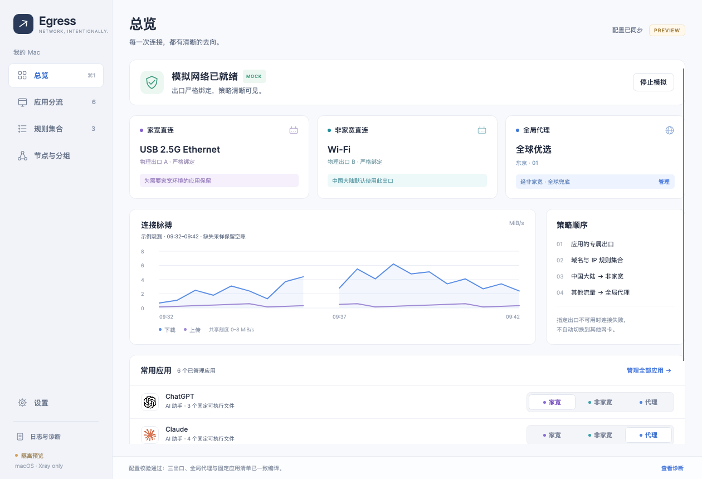

# Egress

Mac 优先的网络出口管理客户端，使用原生 Avalonia、C# / .NET 10 与唯一网络内核 Xray-core。

给应用、域名集合或 IP 集合选择一个出口：**家宽直连 / 非家宽直连 / 指定节点或分组**。国内流量默认走非家宽，其他未匹配流量必须使用全局代理；代理服务器连接也只走非家宽，出口失效不换网卡。

当前交付是可交互的 **隔离预览版**：可搜索和手动添加应用/规则、编辑出口与分组、导入示例 Clash URL、校验和编辑完整 DSL、生成 Xray JSON 与 DAT、模拟配置应用及失败恢复。默认启动不会扫描真实应用、访问真实订阅、改系统网络或安装后台服务。真正的特权助手与实机出口验收尚未启用。



## 在 Mac 上运行

需要 .NET 10 SDK；编译原生桥接/NativeAOT 还需 Xcode Command Line Tools、CMake。Apple Silicon 优先。

```sh
dotnet run --project src/EgressController.Desktop -- --preview
```

使用界面提供的示例订阅 URL 测试完整流程。真实订阅和节点凭据不属于预览数据。UI、DSL 与生成配置使用同一份强类型策略；不支持的协议或插件会明确显示，不能静默转换。

## 验证与打包

```sh
python3 build/Verify-Mac.py
```

该命令只运行 mock 测试、纯 C ABI 探针、普通/紧凑窗口截图与交互验证，并发布 Apple Silicon NativeAOT 预览。截图位于 `artifacts/mac-ui/`，可运行程序为 `artifacts/package/Egress.app`，压缩包及校验和也在该目录。应用为本地 ad-hoc 签名，没有 Developer ID 签名或公证。

只迭代 UI 时：

```sh
dotnet run --project tools/EgressController.MacPreview -- --screenshots artifacts/mac-ui
```

## 设计与技术

- 应用：搜索已安装 App 的模拟目录，手动选择后加入托管列表；保存主程序和 Helper 的固定路径，不按父子进程继承路由。
- 规则：搜索服务分类、添加域名/IP 集合或自定义规则，复用相同的三出口选择。
- 订阅：Clash 只作为节点、分组和 provider 数据来源，不导入它的端口、DNS、TUN 或全局路由。
- 数据：MetaCubeX 原始 YAML 本地编译为 Xray DAT；不依赖 MRS、SRS 或第二网络内核。
- 配置：版本化 YAML DSL → 校验 → Xray JSON/DAT → 完整配置代与失败恢复；历史错误不影响当前健康状态。

参见 [实施与验收范围](docs/mac-implementation-plan.md)、[DSL 与编译](docs/policy-dsl.md)、[macOS C ABI](docs/macos-native.md)、[运行时与持久化](docs/mac-runtime.md)。

旧 Windows 实现在 `EgressController.Windows.slnx` 保留用于历史参考，不是当前主界面的依赖或默认构建目标。
