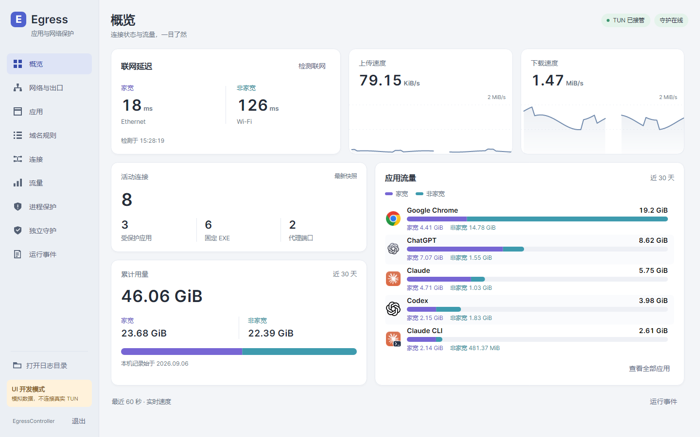

# EgressController

Windows 双网卡分流与应用保护工具。原生 Avalonia 界面，主程序、守护服务和小托盘均使用 NativeAOT。



## 功能

- **两个出口**：从本机网卡中选择 `ESIM-家宽` 和 `Proxy-代理`。支持有线、Wi-Fi、USB 共享和蜂窝；默认精简网卡列表。
- **应用与 CLI**：只列出浏览器、AI 应用和原生 AI CLI。Claude 等应用各显示一个主项，目录内的辅助 EXE 纳入同一固定清单；`Claude CLI`、`Codex CLI` 单独选择。
- **按应用与域名分流**：选择任一网卡直连，或使用本地 SOCKS5 端口。支持多个端口、默认端口、自定义域名和规则集。
- **代理防循环**：根据端口识别代理核心的完整路径，优先绑定到 `Proxy-代理`。多个端口可以共用同一个核心。
- **应用保护**：TUN 未接管、所选网卡不可用或联网检测确认失败时，持续终止勾选的应用。恢复后手动重开。
- **独立守护**：主程序未运行时继续保护最近的名单。小托盘只反映主程序与 TUN 状态，联网检测由主程序独立负责。
- **连接与流量**：近 30 天逐应用累计用量、家宽/非家宽双色分布、每日用量与 60 秒实时速度。活动和历史连接显示进程图标、实际网卡名称及详情。统计采样失败不会重启 TUN 或关闭应用。
- **关键事件日志**：记录启动、停止、重启及触发应用保护的原因。侧栏始终提供“打开日志目录”，不记录每条连接的内核错误。

流量记录保存在本机，关闭应用和重启主程序后仍保留。近 30 天包含今天；只累计已观测的数据，不补造旧版本或主程序未运行期间的历史。

## 开始使用

1. 在 Windows x64 上完整解压发布包，保留 `guard-service`、`guard-tray` 目录，以管理员权限打开主程序。
2. 选择两张不同的网卡。家宽是默认直连与 DNS 出口，代理核心统一使用第二张网卡。
3. 按需添加已有的本地 SOCKS5 端口，并关闭代理软件自己的 TUN。
4. 勾选应用，选择出口，等待 TUN 和网络检查就绪后打开应用。

首次启动默认安装守护服务并启用开机启动；小托盘在登录后出现。主程序与小托盘均可管理服务、关闭自启、停止或卸载守护。
关闭主窗口会隐藏到托盘；明确退出主程序后，独立守护继续工作。

**替换发布包后**：重新打开主程序会自动校验并同步已安装的小托盘，保持原文件名和安装路径，守护服务继续运行。服务协议不兼容时，仍需在主程序中卸载后重新安装服务；保护名单会保留。

规则目录、SRS 和内核下载统一使用当前默认 SOCKS5 端口。启动优先使用已校验的本地内核和规则缓存；资源缺失时自动下载，失败会显示具体资源、端口和原因。

## 保护规则

“递归进程”指扫描目录得到并保存的 **EXE 路径清单**。所有匹配实例都受保护，不根据 Windows 父子 PID 扩大范围；新建文件需要重新扫描。启动应用本身不会新增规则或重启 TUN。旧主项与辅助项使用不同出口时，会提示统一出口；已保存路径不会被丢弃。

CLI 通过 Windows `Get-Command` 查询绝对路径，不会执行 AI 命令。原生 EXE 单独保护，不递归扫描共享 `bin` 目录。仅使用共享 Node/Python 解释器的脚本暂不单列，扫描提示会说明原因。

独立守护每秒核验主程序和 TUN，不进行联网测试。主程序的联网检测每 30 秒一轮，失败后间隔 5 秒复测，连续三次失败才确认；复检期间保留上次结论。DNS 固定为家宽出口的 Cloudflare DoH。

这是检测后终止进程的保护方式，存在检测间隔，不等同于内核防火墙，也不能保证零数据包泄露。未勾选的程序不属于终止范围。

## 开发与预览

需要 .NET SDK（见 `global.json`）；NativeAOT 打包另需 Visual Studio C++ Build Tools 与 Windows SDK。

```powershell
dotnet build EgressController.slnx -c Release -p:EgressMockOnly=true
./build/Invoke-Tests.ps1 -NoBuild

# 独立 UI 开发模式：交互操作只修改模拟数据
dotnet run --project tools/EgressController.UiPreview -c Release

# 自动检查交互、绑定、对比度，并渲染各页面与故障/空状态
dotnet run --project tools/EgressController.UiPreview -c Release -- --screenshots artifacts/ui-preview

# 三个组件的 NativeAOT 发布包与 mock smoke
./build/Package.ps1 -Version 0.1.0
```

预览工具不会初始化生产控制器、TUN、服务、自启项或真实进程控制。CI 仅执行 mock 测试，并提供界面截图与发布包。

[启动恢复复核](docs/startup-recovery-review.md) · [Windows 应用与界面](docs/windows-desktop.md) · [需求复核](docs/requirements-audit.md) · [界面与架构](docs/desktop-design.md) · [应用保护](docs/process-protection.md) · [独立守护](docs/independent-guard.md) · [日志与存储](docs/diagnostics.md)

[MIT License](LICENSE)
