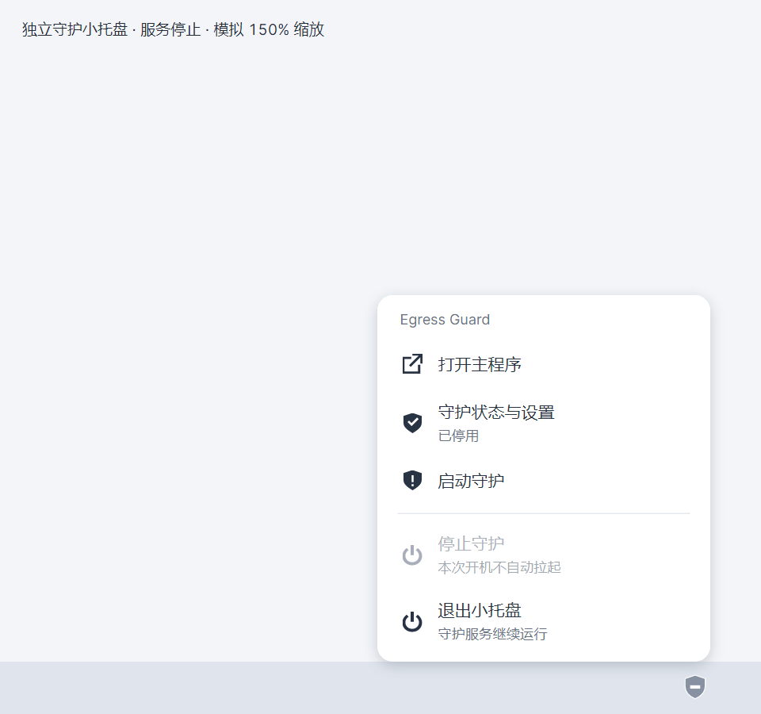
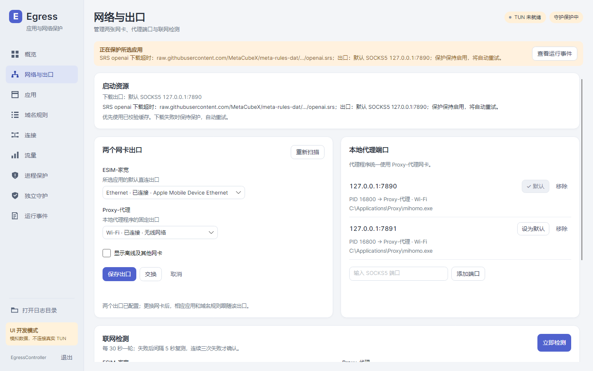

# Desktop design

The reference is Surge's quiet desktop workspace: a stable left navigation, a useful overview,
clear status capsules, generous metric panels and compact connection rows. This is a Windows
network utility, so the native title bar and window controls remain. Chinese labels are primary.

## Design tokens

| Role | Value |
| --- | --- |
| Workspace | `#F3F5F8` |
| Sidebar | `#EBEFF4` |
| Surface | `#FFFFFF` |
| Primary text | `#252C38` |
| Secondary text | `#647084` |
| Accent | `#5062CE` |

Use bundled Inter for Latin text and tabular numerals, with Microsoft YaHei UI fallback for Chinese. Both applications and headless previews use the same font registration. Page titles are 25 px semibold,
section titles 16 px semibold, body/control text 13–14 px, metrics 32–40 px. Do not add all-caps
eyebrows or technical prose to every panel. Icons are an original consistent set of 20 px line
geometries. The sidebar is 204 px; workspace padding is 24 px with a 16 px grid. Content is capped at 1360 px on wide windows.

```
 native Windows title bar
 ┌──────────────────┬──────────────────────────────────────────────┐
 │ brand            │ page title            TUN / guardian status │
 │                  │ short current state                         │
 │ overview         │                                              │
 │ interfaces       │ page content: metrics, forms or table        │
 │ applications     │                                              │
 │ domain rules     │                                              │
 │ connections      │                                              │
 │ usage            │                                              │
 │ protection       │                                              │
 │ guardian         │                                              │
 │ events           │                                              │
 │ logs / preview   │                                              │
 └──────────────────┴──────────────────────────────────────────────┘
```

Cards organize genuinely separate tasks; connection/application screens use flat table rows,
not a card per item. Accent is for navigation and primary actions. Green describes current
healthy state, amber waiting and red an active protection fault. Historical errors are not a
global failure banner. Long executable paths belong in selectable detail areas with tooltips.

## Review against the brief

- Keep the reference's hierarchy, whitespace and restrained depth, while removing macOS traffic
  lights, decorative gradients and unrelated Surge capabilities.
- Do not copy a generic dashboard full of invented counters. Display actual existing metrics;
  preview fixtures are visibly labeled and never appear in production.
- Every page retains working operations from the product. Destructive service actions are
  visually secondary and grouped apart from normal start/refresh actions.
- All command states use explicit colors, keyboard focus and readable contrast. Empty, waiting
  and error views explain what the user can do in a short sentence.
- Capture actual rendered pages at 1440×900 and 1100×760 with normal, offline and empty fixtures.
  Review clipping, density, baseline alignment and disabled controls before publishing.

## Presentation and verification

`EgressController.Presentation` owns shared tokens, vector icons, trend drawing, typography and
`GuardPanel`. App and standalone GuardTray reuse the same components. Each main page and view model
has its own file. Views communicate through `IAppController`; only AppController composes production
services. PreviewController implements the same boundary entirely in memory.

`tools/EgressController.UiPreview` enters irreversible process-local mock mode before initializing
Avalonia. It never constructs AppController. Native headless Skia rendering exercises compiled bindings,
keyboard navigation, button pointer/focus/disabled states, contrast and all management commands with
fake data. CI captures normal (1440×900), compact (1100×760), waiting, network-offline, empty and
telemetry-error scenarios. Ordinary tests also cover protocol, protection, snapshots and file-log filtering.
The dedicated guardian window uses the shared panel; native titlebar/tray shell remains Windows-owned.

## Follow-up: truthful telemetry and companion consistency

Keep one typography system and restrained core colors (workspace #F3F5F8, surface #FFFFFF,
ink #252C38, secondary #647084, accent #5062CE). The small guardian is a compact companion:
brand/open-main toolbar, truthful state hero, concise service/startup controls, structured history
and an always-visible log action. Advanced destructive actions stay available in an expander.
Notification-area registration is native; its rounded Avalonia menu shares the application theme. The shield artwork is shared with the window and
renders at multiple DPI sizes. Healthy, protecting, unavailable and manually stopped states must
have different icon/label treatment; a green check must never appear on an unavailable service.

Traffic charts use actual monotonic observation timestamps over a fixed 60-second window, a
zero baseline and one labeled numeric scale shared by upload/download. Never normalize each
line to its own peak or append points on UI refresh. Missing/initial/stale readings are unknown,
not zero; gaps stay visible. New sessions reset the series. Byte values use explicit IEC units.
Application bars show the current fixed 30-natural-day period, anchored to first opening. Closing does not pause the calendar and pre-existing connections are baselined on reopen. Bar length is relative to the largest application; a tooltip states the scale. Home/other segments use observed bytes, explicit labels and amounts. Shares retain all applications as their denominator. Delay tiles use structured successful probe results rather than parsing text.

```
Guardian                         Traffic
Egress Guard       Open main     Upload 12 KiB/s     Download 1.6 MiB/s
[shield] Current state           2 MiB/s ─────────   2 MiB/s ─────────
Reason + last refresh           1 MiB/s ─────────   1 MiB/s ──/──/───
Service / startup / normal ops   0       ──____───   0       ─────────
Recent protection records               -60s now            -60s now
Advanced service controls        one scale, real timestamps, visible gaps
Log directory
```

Review scope follows the latest corrections: recursive **saved EXE paths**, no ParentPid
membership, no launch-triggered configuration/TUN changes; guardian main/TUN only; main
network protection keeps 30 s / 5 s / three failures; telemetry and file-log failures have no
protection authority. Add mock assertions for these boundaries instead of reintroducing older
requirements from superseded conversation turns.

## Updated previews


## Windows polish pass

Mode: **Operate**. Preserve the sidebar and information architecture. Refine the existing Surge-inspired
world with Windows-native typography, a calmer workspace, brighter readable surfaces, restrained offset
shadows, 36 px controls, 8 px control corners and 12–15 px panel/menu corners. Use actual product artwork
and exact route names, not decorative badges or invented statistics.

The main menu and guardian menu now share a measured rounded surface with keyboard focus, disabled and
stop states. A Win32 notification host obtains the icon rectangle and owning monitor work area/DPI;
menu placement uses physical pixels exactly once. This avoids the primary-screen scaling assumption
in Avalonia 12.1.1's stock tray implementation. No private Avalonia APIs or WebView are used.

Applications, connection rows, the inspector and application traffic share a bounded visual cache.
Windows EXE resources are extracted at 64 px off the UI thread; a neutral vector is shown while loading
or if the icon is unavailable. CLI entries reuse the product artwork with a small terminal marker.
Complete paths and adapter descriptions remain accessible in details/tooltips.

Visual review used frontend-design and Impeccable's polish/Operate guidance. Its web-oriented detector
does not inspect AXAML; native headless rendering, compiled bindings and interaction/contrast checks
remain the verification path. Three screenshot passes cover all nine pages at ordinary/compact sizes,
companion states, tray menus, keyboard focus and filtered CLI rows. These are mock previews, not a live
TUN or a real notification-area integration test.


## Startup recovery follow-up

The installed companion now synchronizes its UI payload from the replaced release directory on main
startup, so the shared menu design reaches existing installations as well. Its file name and install
location remain stable; the protection service is not stopped to update the UI. The menu's visible card,
rather than transparent shadow padding, is constrained to the owning monitor's work area. Pointer opening
is quiet; keyboard focus remains explicit. Mock taskbar scenes cover 100%, 150% and 200% scaling.

The network page shows startup resource progress and the actual default SOCKS5 endpoint. A download
failure names the resource and route. A fresh attempt displays its current progress while retaining
previous failures in event history. The preview's unavailable states do not seed fictional successful
TUN/network events.





The final placement scenes use **GuardTrayCommands**, the same command factory used by the real
independent guardian tray. Capture service-stopped and service-running states at all three DPI scales,
including the correct shield icon and start/stop enablement. Main-application tray examples are not
accepted as evidence for the companion-specific issue.

## Monthly traffic and typography refinement

The quota/remaining allowance editor and ring have been removed. Traffic now separates **home**
(iris #7766D4) from **other** (teal #3E9BAE). Exit labels use darker related text colors, checked
against a 4.5:1 contrast threshold. Unknown exit bytes remain gray and explicitly labeled; they are
never silently attributed to an interface. Speed curves use neutral steel blue so upload/download
do not acquire the home/other color meanings.

Both delay values use the same 32 px tabular numerals and baseline. Compact rate units, subtle
separators, restrained borders and a maximum content width preserve density at 1100–1920 px.
Application and domain rows use one complete route selector. The selector retains the existing
transactional save behavior, default options, adapter names and proxy ports. Connection rows use
right-aligned numbers, alternating surfaces and an explicit selection/focus state.

The standalone guardian shares these tokens and fonts, uses a quieter service disclosure, and
keeps log actions available at compact heights. Its advanced section is keyboard accessible and
scrolls its first action into view. UI capture verifies actual usage row visibility, equal delay
size/baseline, color contrast, navigation, service commands and ordinary/compact/wide layouts.

Native guidance: [Avalonia-skills](https://github.com/linuxdevel/Avalonia-skills), especially
avalonia-pro-max/design-system, components and styling. The existing Impeccable Operate/polish
workflow supplies visual review. Web-specific framework recommendations from ui.md were not used
as Avalonia APIs. No theme-framework replacement or WebView was required.

## Application catalog refinement

The application page adds a quiet 144 px category rail with counts, a shared searchable list and
manual category selectors. All new items start unclassified; categorization never chooses a route.
Known brands are optional naming/artwork hints, not a catalog allowlist. Registered games remain
independent from their launchers. Compact selectors, popup checkmarks, rounded surfaces and focus
styles reuse the same theme in both desktop applications. Changing a row preserves scroll position;
500-row previews verify virtualization.

All process artwork passes through AppAvatar. Cached alpha-aware luminance analysis chooses a dark
backing for white/pale logos and a light backing for dark/color logos. Native artwork is neither
recolored nor stretched. Contrast fixtures cover 22/28/32/48 px, CLI marks and normal/hover/selected
backgrounds. The same control is used in application, connection, traffic and detail views.

Discovery references: [BCUninstaller source](https://github.com/BCUninstaller/Bulk-Crap-Uninstaller/tree/master/source/UninstallTools/Factory),
especially RegistryFactory/MsiInfoAdder and SteamHelper's library/app manifests. Only install metadata
patterns were adopted; no uninstall/residue-removal operations or drive crawling are included.
