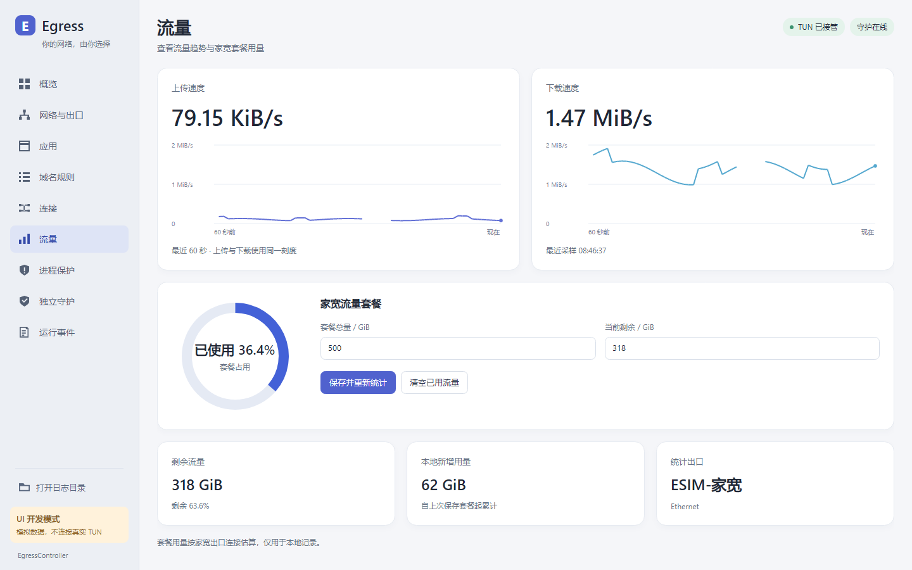
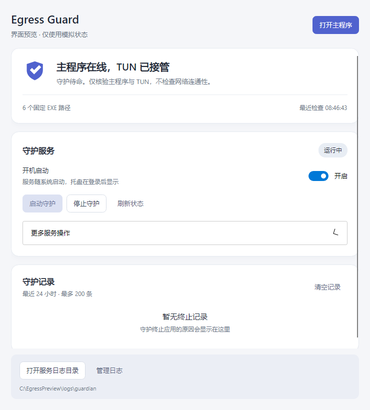
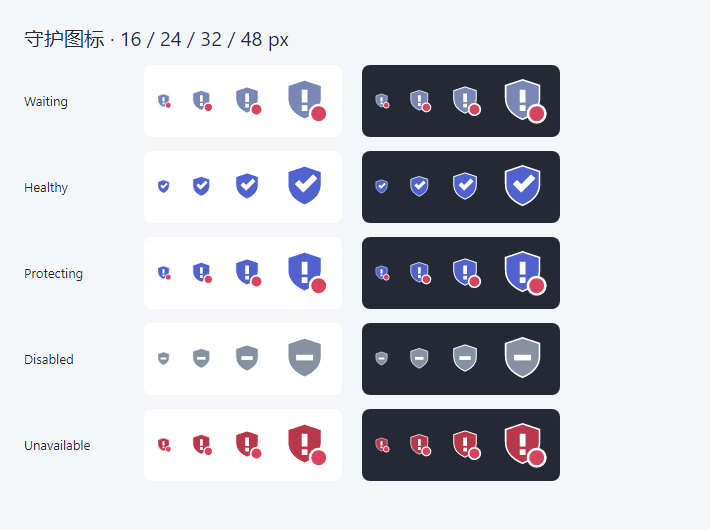

# Desktop design

The reference is Surge's quiet desktop workspace: a stable left navigation, a useful overview,
clear status capsules, generous metric panels and compact connection rows. This is a Windows
network utility, so the native title bar and window controls remain. Chinese labels are primary.

## Design tokens

| Role | Value |
| --- | --- |
| Workspace | `#F5F6F9` |
| Sidebar | `#ECEFF4` |
| Surface | `#FFFFFF` |
| Primary text | `#202735` |
| Secondary text | `#667184` |
| Accent | `#5062CE` |

Use Segoe UI with Microsoft YaHei UI fallback for Chinese. Page titles are 27 px semibold,
section titles 16 px semibold, body/control text 13–14 px, metrics 32–40 px. Do not add all-caps
eyebrows or technical prose to every panel. Icons are an original consistent set of 20 px line
geometries. The sidebar is 220 px; primary workspace padding is 28 px with a 16 px grid.

```
 native Windows title bar
 ┌──────────────────┬──────────────────────────────────────────────┐
 │ brand            │ page title            TUN / guardian status │
 │                  │ short current state                         │
 │ overview         │                                              │
 │ interfaces       │ page content: metrics, forms or table        │
 │ applications     │                                              │
 │ domain rules     │                                              │
 │ connections      │                                              │
 │ usage            │                                              │
 │ protection       │                                              │
 │ guardian         │                                              │
 │ events           │                                              │
 │ logs / preview   │                                              │
 └──────────────────┴──────────────────────────────────────────────┘
```

Cards organize genuinely separate tasks; connection/application screens use flat table rows,
not a card per item. Accent is for navigation and primary actions. Green describes current
healthy state, amber waiting and red an active protection fault. Historical errors are not a
global failure banner. Long executable paths belong in selectable detail areas with tooltips.

## Review against the brief

- Keep the reference's hierarchy, whitespace and restrained depth, while removing macOS traffic
  lights, decorative gradients and unrelated Surge capabilities.
- Do not copy a generic dashboard full of invented counters. Display actual existing metrics;
  preview fixtures are visibly labeled and never appear in production.
- Every page retains working operations from the product. Destructive service actions are
  visually secondary and grouped apart from normal start/refresh actions.
- All command states use explicit colors, keyboard focus and readable contrast. Empty, waiting
  and error views explain what the user can do in a short sentence.
- Capture actual rendered pages at 1440×900 and 1100×760 with normal, offline and empty fixtures.
  Review clipping, density, baseline alignment and disabled controls before publishing.

## Presentation and verification

`EgressController.Presentation` owns shared tokens, vector icons, trend drawing, typography and
`GuardPanel`. App and standalone GuardTray reuse the same components. Each main page and view model
has its own file. Views communicate through `IAppController`; only AppController composes production
services. PreviewController implements the same boundary entirely in memory.

`tools/EgressController.UiPreview` enters irreversible process-local mock mode before initializing
Avalonia. It never constructs AppController. Native headless Skia rendering exercises compiled bindings,
keyboard navigation, button pointer/focus/disabled states, contrast and all management commands with
fake data. CI captures normal (1440×900), compact (1100×760), waiting, network-offline, empty and
telemetry-error scenarios. Ordinary tests also cover protocol, protection, snapshots and file-log filtering.
The dedicated guardian window uses the shared panel; native titlebar/tray shell remains Windows-owned.

## Follow-up: truthful telemetry and companion consistency

Keep the same Windows typography and five core colors (workspace #F5F6F9, surface #FFFFFF,
ink #202735, secondary #667184, accent #5062CE). The small guardian is a compact companion:
brand/open-main toolbar, truthful state hero, concise service/startup controls, structured history
and an always-visible log action. Advanced destructive actions stay available in an expander.
Native notification-area menus remain native; the shield artwork is shared with the window and
renders at multiple DPI sizes. Healthy, protecting, unavailable and manually stopped states must
have different icon/label treatment; a green check must never appear on an unavailable service.

Traffic charts use actual monotonic observation timestamps over a fixed 60-second window, a
zero baseline and one labeled numeric scale shared by upload/download. Never normalize each
line to its own peak or append points on UI refresh. Missing/initial/stale readings are unknown,
not zero; gaps stay visible. New sessions reset the series. Byte values use explicit IEC units.
App bars show each application's fraction of all observed active-connection bytes, not a fraction
of the largest row. Delay tiles use structured successful probe results rather than parsing text.

```
Guardian                         Traffic
Egress Guard       Open main     Upload 12 KiB/s     Download 1.6 MiB/s
[shield] Current state           2 MiB/s ─────────   2 MiB/s ─────────
Reason + last refresh           1 MiB/s ─────────   1 MiB/s ──/──/───
Service / startup / normal ops   0       ──____───   0       ─────────
Recent protection records               -60s now            -60s now
Advanced service controls        one scale, real timestamps, visible gaps
Log directory
```

Review scope follows the latest corrections: recursive **saved EXE paths**, no ParentPid
membership, no launch-triggered configuration/TUN changes; guardian main/TUN only; main
network protection keeps 30 s / 5 s / three failures; telemetry and file-log failures have no
protection authority. Add mock assertions for these boundaries instead of reintroducing older
requirements from superseded conversation turns.

## Updated previews






