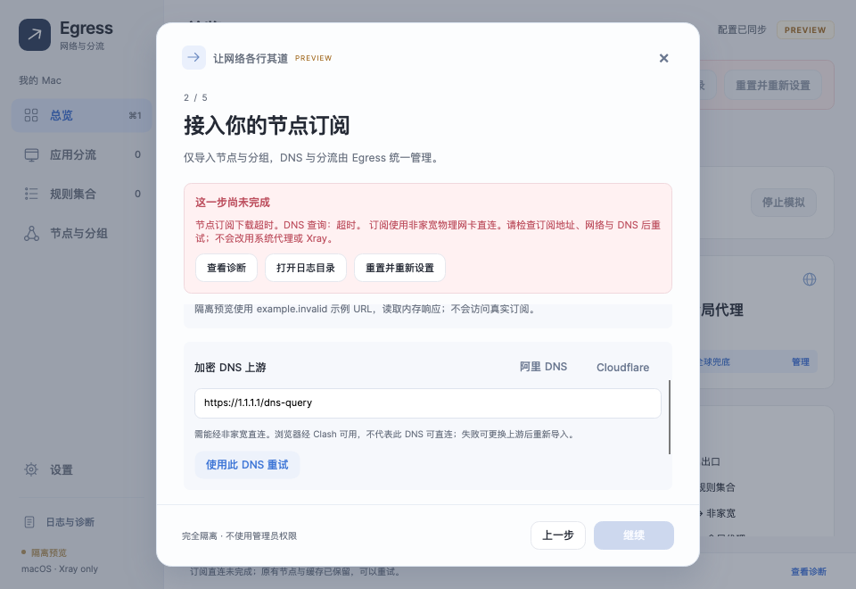

# Direct DNS bootstrap and subscription recovery — 0.1.11

## Reproduced failure

The selected physical Wi-Fi identity stayed the same while its upstream network changed. On the earlier network, the existing bound downloader could reach Cloudflare DoH and fetch the subscription. On the user's current network, with Clash available, the same production DNS/downloader components reproduced a failure at roughly two seconds:

| Operation | Path | Result |
| --- | --- | --- |
| Same subscription | Explicit Clash loopback proxy | HTTP 200 |
| Configured `1.1.1.1:443` DoH | Physically bound Wi-Fi | TCP timeout |
| Production DNS resolver using that endpoint | Physically bound Wi-Fi | DNS failure at approximately 2 s |
| Same downloader, DNSPod DoH substituted in an isolated diagnostic | Physically bound Wi-Fi, no proxy | HTTP 200, approximately 2.18 s |
| Same downloader, AliDNS DoH substituted | Physically bound Wi-Fi, no proxy | HTTP 200, approximately 3.24 s |
| Subscription HTTPS to each independently resolved IPv4 address | Physically bound Wi-Fi, correct TLS hostname, no proxy | HTTP 200 for both |
| Complete subscription download and parse with AliDNS | Production components, in-memory resource cache, bound Wi-Fi | Successful |
| Home-only HTTPS 204 check with AliDNS | Bound iPhone USB | Successful |

The diagnostic verified that the subscription URL's local identity matched the screenshot without printing its URL or token. It did not enter production application initialization, install/start/stop a helper, create TUN or alter system DNS/routes/proxy settings. The user independently enabled Clash TUN during investigation; subsequent bound requests retained the physical Wi-Fi exit. A plain curl comparison using system DNS was not sufficient evidence of site reachability, so the final comparison used independently verified answers and the actual bound DoH component.

The immediate reproducible cause is an unreachable DNS bootstrap endpoint. A physical interface being active, or a browser working through Clash, does not prove that this interface can directly reach that endpoint. The existing subscription pipeline already recreated its HTTP/DNS clients and read live interface identity for each attempt; it did not pin the old Wi-Fi gateway or local address.

## Shared dependency and fixes

Subscription/provider resolution, home checks, compiled Xray DNS and probe configurations consume the policy's encrypted DNS setting. Xray DNS queries are tagged and routed to the bound non-home outbound, independent of global proxy selection; proxy servers also connect through non-home. Probe HTTP targets travel through the tested node. An unreachable bootstrap endpoint can prevent node resolution before the node is usable. This explains a shared risk, but does not establish the cause of every historical node or TUN failure.

- New/reset policies and DSL with omitted DNS now default to `https://223.5.5.5/dns-query`. Custom/saved DNS choices are preserved. AliDNS was verified with the real RFC 8484 POST resolver and TLS certificate validation on both physical exits. It is still subject to actual network/provider availability. See Alibaba's [Public DNS service and supported transports](https://www.alibabacloud.com/help/en/dns/public-dns-free-version-access-speed-limit-notification-dns).
- DNSPod's literal IP endpoint was used only as a diagnostic comparison, not added as a preset; its provider [recommends migrating to domain access](https://docs.dnspod.cn/notices/mian-fei-ban-dot-dohbu-zai-gong-kai-ipjie-ru-de-gong-gao/).
- Setup now exposes the same DNS editor as Settings, including AliDNS, Cloudflare and custom literal-IP HTTPS input. A DNS failure reveals the repair panel with an explicit retry action. Changing DNS updates its IP metadata and invalidates home-check evidence without restarting the core or clearing application inventories.
- Imports use an immutable policy snapshot. All DNS, connection, redirect and body requests remain on its selected physical exit with `UseProxy=false`. There is no automatic Clash/system-proxy or other-interface fallback.
- Sanitized transport facts survive SocketsHttpHandler and resource-preparation wrappers: bind/DNS/TCP/TLS/HTTP/body stage, fixed reason code and optional HTTP status. Nested DNS cancellation is recorded as timeout. Raw exception messages, URLs, tokens and response bodies are not retained.
- Each production import logs its live BSD interface, service identity, active/address counts, DNS host, direct/no-system-DNS/no-proxy path, duration and outcome. User-facing errors show actionable reasons instead of internal subscription hashes.

The user's current Egress draft was repaired separately under the application's exclusive workspace lease, after checking both exits. A private, timestamped pre-repair backup was saved, only the DNS fields changed, and the checksummed draft was read back. The diagnostic subscription parse was not saved to the user's configuration. System networking and Clash remained untouched.

## Validation

The isolated tests cover HTTP 401/403/429/503, wrapped DNS timeout/unreachable causes, credential redaction, fixed-interface binding, cancellation, cache preservation, custom DNS preservation, and application inventory preservation after DNS repair/retry. The UI audit exercises actual preset/retry clicks at 1260 × 860 and 960 × 660, visible repair actions, disabled Continue for an empty failed import, and all existing pages.

Run `python3 build/Verify-Mac.py --version 0.1.11` for the complete managed, native ABI, synthetic Xray RPC, UI and NativeAOT mock suite. Live diagnostics and the explicitly requested draft repair are separate from this automated suite. Neither the live downloader result nor mock routing checks claim end-to-end production TUN takeover or connectivity of every subscription node.

Local acceptance passed 590 managed tests (Policy 116, Runtime 188, Mac 196, Client 90), two pure ABI checks, synthetic Xray RPC/DAT validation, all isolated UI suites and the 0.1.11 NativeAOT package mock-smokes.
