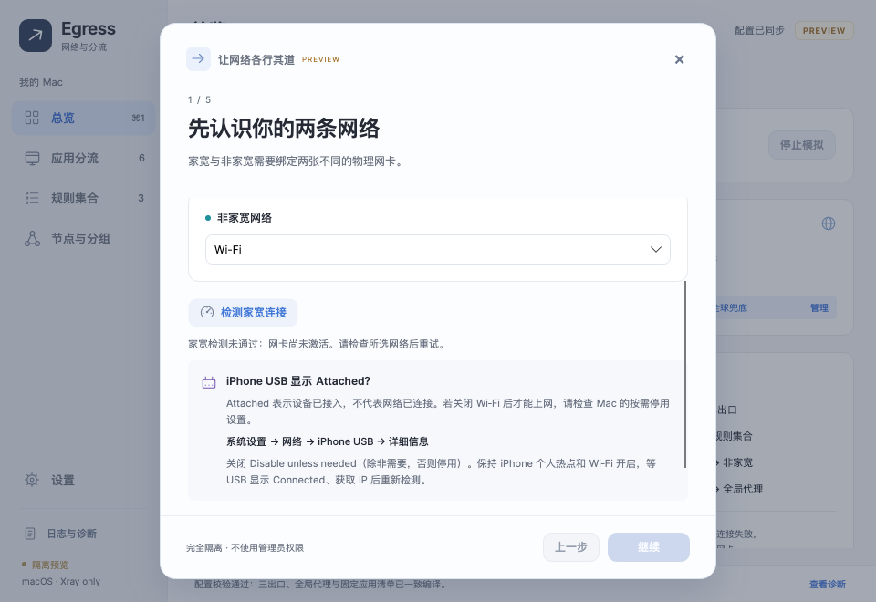

# Home connectivity and iPhone USB — 0.1.10

## Setup feedback

The first setup step checks only the selected home interface. It requires HTTPS with an exact HTTP 204 from Cloudflare or Google before enabling Continue. No proxy or other physical interface is a fallback. A successful check expires after two minutes; changing the home interface or DNS invalidates it. This setup check does not change the separate rule that TUN startup can proceed while physical links are offline.

An unsuccessful check now reveals inline USB guidance. If iPhone USB shows **Attached**, or only works after Wi-Fi is turned off, open **System Settings → Network → iPhone USB → Details** and turn off **Disable unless needed**. Leave Personal Hotspot and Wi-Fi enabled, wait for a connected USB interface with an IP, then retry. Attached alone is not proof of an active Internet connection. The app presents this as conditional advice; it does not read or change that macOS preference. Apple's [USB connection options](https://support.apple.com/en-afri/guide/mac-help/mchl7594e36f/mac) document this setting.

The setup backend distinguishes a missing interface, an inactive interface, and an interface without a usable IP before DNS/HTTPS. Loopback, unspecified, multicast and link-local-only addresses do not establish readiness. Subsequent socket failures retain their network-unreachable/refused/timeout cause through DNS and HTTP wrappers; stack-frame class names no longer misclassify them as DNS failures. Logs record interface identity, active state, address count, endpoint, result code and duration, without addresses, credentials or request bodies.

Retry clears the previous advice while pending; success, cancellation, configuration changes and reset clear it. The fixed heading and footer stay in place. A completed failed check reveals the advice within the scrollable body, and keyboard focus returns to the check button after its temporary disabled state. No periodic status refresh scrolls the wizard.

## Authorized live diagnostic, 2026-11-01

The user explicitly requested an independent Xray test. A temporary, hash-verified bundled Xray served an ephemeral loopback SOCKS listener with a freedom outbound bound to the specified physical interface using Darwin IP_BOUND_IF. It had no TUN, helper or system proxy changes. Literal-address DoH and HTTPS 204 requests used that bound route, without direct/system proxy fallback. Each owned diagnostic process was stopped after its run.

Before the macOS preference change, iPhone USB was inactive, had no IP or scoped default route, and both bound Xray and a direct Darwin-bound socket failed with network unreachable. Wi-Fi succeeded as a control. After the user changed the setting, USB was active with an IP and scoped route while the default route still belonged to Wi-Fi:

| Bound interface | Literal DoH | Cloudflare 204 | Google 204 |
| --- | --- | --- | --- |
| iPhone USB | 200, 0.899 s | 204, 1.813 s | 204, 1.205 s |
| Wi-Fi control | 200, 0.750 s | 204, 1.511 s | 204, 0.850 s |

The default route was unchanged after the run. These measurements confirm independent USB HTTPS reachability while Wi-Fi remains enabled; they do not claim an end-to-end production TUN or application routing test. Raw diagnostic output stays outside the repository.

## Isolated regression coverage

- Runtime fixtures cover readiness states, strict 204 behavior, cancellation, bound DNS, and nested socket error classification.
- Client fixtures cover failure reasons, stale-advice clearing on retry/success/cancellation/interface and DNS changes, and the Continue gate without starting the core.
- Headless previews perform actual pointer failure/retry at 1260 × 860 and 960 × 660, checking help visibility, viewport containment, fixed actions, keyboard focus and successful recovery. The wider UI audit still exercises all pages and setup steps.
- Preview backends use unique saved-policy and backup filenames, preventing concurrent fixture instances from overwriting each other's synthetic reset data.

Run `python3 build/Verify-Mac.py --version 0.1.10` for the managed, UI, native ABI, synthetic Xray RPC and NativeAOT package checks. It does not repeat the live diagnostic or touch system network state.

Local acceptance passed 583 managed tests (Policy 116, Runtime 182, Mac 196, Client 89), two pure native ABI checks, the synthetic Xray RPC regression, all isolated UI suites and the 0.1.10 NativeAOT package mock-smokes.
