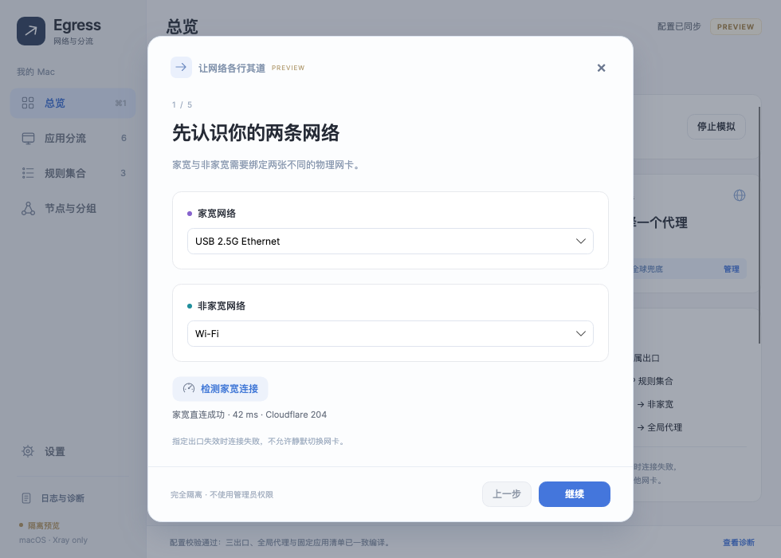
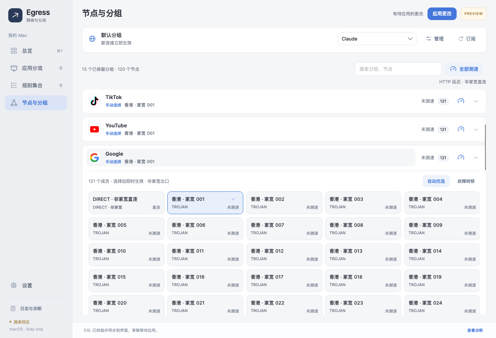

# Workspace reliability and visual refinement

The 2026-11-01 follow-up fixes several different failures rather than treating a passed build as evidence of a usable workspace.

- Application enrollment previously updated memory and reported “saved” without writing the draft. Add now awaits a durable snapshot, and onboarding Continue enrolls checked applications before advancing. Explicit inventories and route assignments survive reopening; incomplete scans do not advance. Ordinary edits debounce into a serialized draft writer; reset cancels old writes and publishes its empty state under the same gate. Production draft I/O runs off the UI thread.
- Probe commands previously used the global busy state and compiled every subscription node for each measured node. They now have independent cancellation/progress, six bounded processes, an eight-second deadline and compact dependency-only configurations. Proxy transport and resolver sockets remain bound to non-home; no listener, API, TUN or system-proxy fallback is introduced. Measurements remain Xray HTTP GET latency, not bandwidth or ICMP. Result publication coalesces callbacks and rejects obsolete draft revisions.
- Group and member objects remain stable across latency updates. The list does not auto-scroll to selected containers. Invalid unselected items are hidden; a removed current member stays visible and disabled for repair. A fresh failed probe is visibly unavailable and cannot masquerade as zero latency. Retained group choices survive imports and continue to preserve nested dependencies.
- Native PNG requests are made on app/catalog presentation and search, with coalesced layout/scroll intent, bounded caches and negative caching. Bundled Gemini, TikTok, Microsoft, PayPal, Twitter and Telegram artwork fills missing group coverage. Exact known bundle metadata supplies fallback artwork; native PNG takes precedence. Iconography is presentation metadata, never routing identity.
- A failed helper read previously cleared Running, allowing shutdown to skip cleanup after a failed stop. The backend now keeps a separate recovery obligation until an acknowledged stop. Closing cancels and awaits owned work, saves pending configuration, and restores networking even if draft saving fails. A failed restore leaves the window open for retry. An unused/untrusted helper does not trap a client that never owned networking. The root helper verifies committed DNS presence/enabled state/plist dictionary, waits for its recorded TUN takeover to disappear, and retains the recovery journal on failure. This checks owned system state, not Internet reachability.

The presentation uses the existing native Avalonia/Inter/CJK stack with a narrower sidebar, compact page header, calmer shared surfaces, soft buttons, gauge icons with accessible labels, product artwork, equal-width responsive member tiles and a collapsed successful connection panel. No WebView or runtime icon download is used.

Design references: supplied desktop Surge Activity/dashboard and Stash screenshots. Interaction research: [Surge testing](https://manual.nssurge.com/tools/testing.html), [Surge URL-test groups](https://manual.nssurge.com/policy-groups/url-test.html), [Stash proxy groups](https://stash.wiki/en/proxy-protocols/proxy-groups). Surge's HEAD/two-round scoring is not claimed for the pinned Xray GET observatory.

Verification includes application selection/reopen, missing-member repair, slow-probe navigation/cancel, close-during-probe, save failure versus cleanup, retry after failed restore, stale results, unavailable helper status, compact configuration size/concurrency, and actual headless pointer/keyboard/render checks. A synthetic 120-node/13-group workspace measures publication plus render and verifies unchanged row objects and scroll offset. All data is synthetic; native probes are pure ABI tests. Normal/compact screenshots cover member hover/pressed/focus/disabled states and production-shaped native PNG presentation. No real TUN, user configuration, DNS/routes or protected applications are changed by these tests.

These checks do not establish that the user's reported Internet outage is resolved on the live dual-interface network. The read-only lifecycle evidence showed an acknowledged stop; it did not verify post-exit connectivity. Recovery is now stricter, and logs retain a retryable failure instead of closing on an unconfirmed result.

## Reset after upgrading the GUI (0.1.7)

The read-only 09:32 helper log identified `helper.identity` / `gui-digest-changed; reinstall-current-build`. The 0.1.6 reset treated an installed file as a usable helper, required a successful stop, and repeatedly refused the local reset after that authentication rejection. This is separate from the earlier routing failure.

Reset now returns a typed network-recovery outcome. A missing/unavailable helper or failed restore cannot veto the explicit local reset. Backup and empty-draft persistence remain mandatory; storage failures and caller cancellation cannot be treated as reset success. In 0.1.7 the privileged DNS/TUN journal, caches, logs and usage were untouched; 0.1.8 expands generated-cache cleanup as described below. A session that previously owned networking retains its recovery obligation and launch context until acknowledged restoration; no unconfirmed state is reported healthy. Automatic group work and pending draft writes remain serialized/cancelled before reset.

The setup overlay and main workspace expose an independent recovery notice. “修复助手并恢复网络” prepares only the bundled core, verifies or reinstalls the current helper identity using the existing administrator authorization, and requests StopAndRestore. It never applies a new generation, starts TUN, clears newly entered settings, or runs automatically as part of reset. Status-read failures are shown as unavailable, not “not installed”; a stopped core with unrestored DNS is not considered ready.

Regression coverage includes EOF from a rejected helper, a false stop reply, mandatory backup, cancellation, storage failure, durable empty-draft reload, continuing setup while recovery is pending, failed repair/retry, no automatic authorization, and no core restart on repair. Headless pointer tests reproduce confirmation with an unavailable helper and inspect 980×700 and 1260×860 renders. These are isolated tests; no installed helper, user configuration, DNS or routes were changed during validation.

## Interface connectivity, complete reset and viewport anchoring (0.1.8)

Desktop references 2-5 showed an attached iPhone, a home-labelled connection observation,
only two successful group measurements, and a Google header shifting after expansion.
Neither an attached link nor an access log proves Internet reachability. Read-only helper
logs confirmed an earlier identity mismatch and later acknowledged restoration, but lacked
per-probe causes. User screenshots and credentials are not included in this repository.

First-run Continue requires a successful home-only HTTPS 204 request, first to Cloudflare
then Google. DNS is RFC 8484 POST through the same bound home interface. HTTP 200,
redirects, DNS/TLS/binding failures and cancellation do not pass. Changing home or DNS
invalidates the proof; it expires after two minutes. This check starts no core/helper/TUN
and never tests non-home. The Mac catalog also reads IPv4/IPv6 addresses from
SystemConfiguration service keys used by USB tethering. Reachability is a separate check;
after setup, physical reachability still does not control TUN lifetime.

The previous runtime sent plaintext DNS and randomly chose an address when multiple A/AAAA
answers existed. Runtime compilation now uses certificate-verified literal-IP DoH routed
through non-home, re-resolves sniffed HTTP/TLS/QUIC names, and enables bounded same-interface
address racing (250 ms stagger, at most two attempts, IPv4 first). This does not switch
physical exits. ECH and pure-IP connections cannot recover a hostname through sniffing.
Bound subscription/home DNS resolves both families independently with a two-second family
budget; one failed family no longer discards a usable answer. HTTPS dial attempts have a
two-second per-address budget within the caller's deadline. The helper independently rejects
plaintext/local DNS modes, implicit DNS bootstrap and unbounded/unbound dialing.

Primary implementation references at pinned Xray commit `0afec66`:
[Darwin binding](https://github.com/XTLS/Xray-core/blob/0afec66/transport/internet/sockopt_darwin.go),
[address dialing](https://github.com/XTLS/Xray-core/blob/0afec66/transport/internet/dialer.go),
[routed DoH](https://github.com/XTLS/Xray-core/blob/0afec66/app/dns/nameserver_doh.go),
[GET observatory](https://github.com/XTLS/Xray-core/blob/0afec66/app/observatory/observer.go).
These identify concrete reliability defects; they do not prove the sole cause of the
reported live iPhone outage. No real network takeover or reachability test was run here.

Probe logs identify run, node ID, protocol, selected non-home service/BSD interface,
test host (never full URL), elapsed time and fixed failure category. Both node transport and
DNS remain bound to non-home, with no TUN/inbound/system proxy. DIRECT results now display
actual measurements too. An old failed measurement does not lock manual selection.
`network-diagnostics.log` is capped at 512 KiB. Root `network-errors.log` is capped at
256 KiB and aggregates fixed error categories at most once per 30 seconds/category;
raw core lines, destinations and secrets are never persisted. It is diagnostic only and
cannot set protection state. The log-directory action copies bounded root lifecycle and
network snapshots beside the GUI logs.

Reset removes user runtime generations, resource/subscription caches, probe directories and
helper staging, while retaining the durable before-reset backup, usage, logs and verified
bundled core. A durable pending-cleanup marker survives restart. The helper's authenticated
ResetAndRestore command completes DNS/routes/TUN recovery before removing root generated
generations/assets; recovery journal and installation identity are never blindly deleted.
Partial cleanup returns an empty local setup with a separate recovery warning, not the old
policy. Retry/repair completes cleanup before future apply. A shared workspace file lease
prevents new Debug/Release/installed versions from writing concurrently. An already-running
older build has no lease support and should be exited before the first upgrade. Helper GUI
hash authentication remains enforced; changed native builds still require authorization.

Group headers use a nonvirtualizing StackPanel so expanding a large group cannot change the
estimated extent of offscreen groups. Member controls remain deferred until expansion;
rows/selection survive probe publication. A headless test scrolls to the bottom, clicks Google
three times and asserts its pixel Y position is unchanged, then checks latency publication
and compact layout with 120 nodes/13 groups. Synthetic screenshots cover both window sizes.

