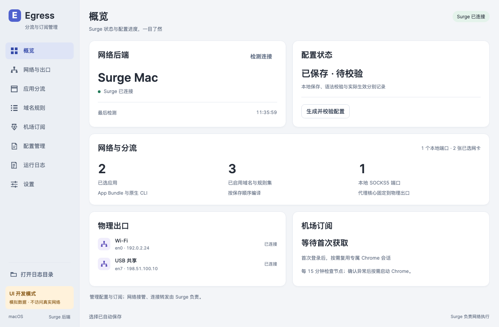
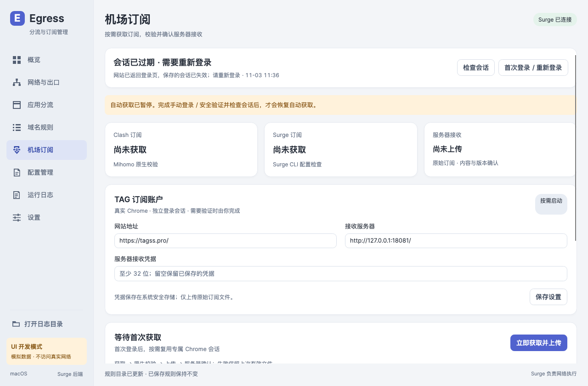
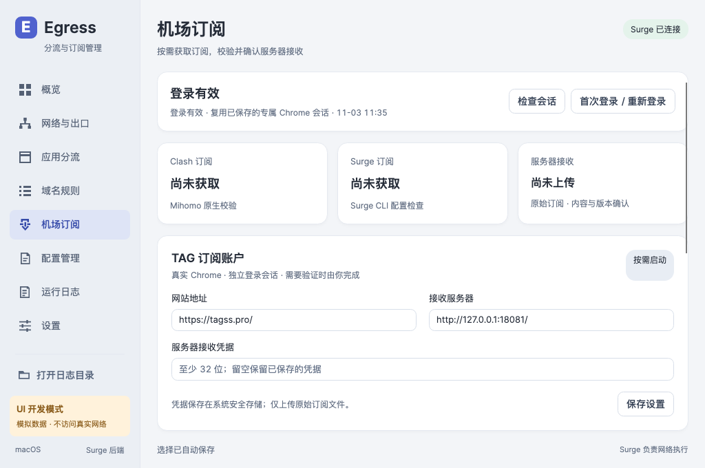

# macOS manager

## Scope and workflow

The macOS Avalonia app manages configuration and subscriptions. Surge owns traffic forwarding and network takeover. There is no TUN start/stop, guardian, process termination, startup installation or duplicate traffic screen. Windows retains its existing routing schema, explicit EXE inventory and guardian/network logic; only shared presentation assets and the new subscription page cross the boundary.

Select physical adapters by their stable hardware identity, detect existing loopback SOCKS5 ports and verify the exact native owner executable, then choose App Bundle/native CLI/domain/rule-set destinations. A proxy core's own PROCESS-NAME bypass precedes application rules and binds to its chosen physical adapter. Shared script runtimes are rejected. Missing adapters and saved app paths remain selected until the user changes them. Categories are separate metadata and survive unchecking.

The output is a complete private Surge CONF. The app validates a candidate with `surge-cli --check`, publishes `profiles/last-valid.conf` only after success, and keeps the previous valid file. Restore affects the candidate only. **Import and activation are manual in Surge.** This implementation never reloads or switches the active profile; a successful syntax check is displayed as pending manual application. Real activation is a user acceptance step.

Rule catalogs use the selected default SOCKS5 transport and validated local cache. Generated RULE-SET URLs are downloaded by Surge when the user imports the profile. Updating a catalog does not silently change selections. Raw subscription files stay under `subscriptions/`; only their Proxy definitions can enter a private runtime profile. General, Script, MITM and remote groups are never imported from that raw source.

## Login and expiry

Choose **首次登录 / 重新登录** to open a normal Chrome window using the application's private profile. Log in and solve any site verification yourself. Quit this dedicated Chrome (`⌘Q` on macOS), then choose **检查会话**. The application does not store or submit the airport password. Chrome persists cookies and website storage. Other personal Chrome profiles are not read or modified.

- Account page confirmed: login valid, with observation time.
- An old saved valid state: saved session, pending confirmation.
- A login page before any successful verification: not signed in.
- A login page after an earlier successful verification: session expired, manual relogin needed.
- Security challenge: verification blocked, automatic refresh paused.
- Network/page/browser failure: unknown; never called expired.

TAG's 15-minute subscription enable switch is independent of login expiry. Refresh opens that window, chooses actual Clash Meta and Surge controls, obtains each raw file separately and never clicks a client import action. There is no promise of permanent authentication: the site controls expiry and revocation. Optional six-hour session checks reuse the profile only while automatic checks and healthy backend/network observations are available; a challenge or expiry pauses browser work until manual verification.

## Validation, upload and scheduling

Mihomo runs only with `-t`; macOS Surge runs only with `--check`. Windows uses a clearly labeled structural Surge check because Surge has no Windows CLI. Configure installed executable paths in the subscription page. All capture formats validate before a pending immutable batch is published. Upload retries preserve bytes, timestamp and client version and do not reopen Chrome. Settings cannot redirect an existing pending batch to another server. Receipts must confirm format, exact SHA-256, client version and a server revision.

Ingress credentials and the Surge API key use Keychain on macOS / Credential Manager on Windows. Private files use user-only permissions and atomic replacement. No account, token, raw subscription or real profile belongs in screenshots or source control.

Automatic macOS rounds run every 15 minutes in the GUI or optional Agent, sharing an OS-owned lock and persisted cooldown. Surge HTTP API must already be configured; EgressController never changes the live Surge profile to enable it. External policy identifiers remain unknown until batch-test support is verified. The condition engine supports regex groups, percentage/all-timeout/success-below, AND/OR, consecutive rounds, age and cooldown; the initial UI edits one percentage group. Missing/stale/unsupported measurements do not count as failures. A failed DIRECT control or backend prevents refresh. Windows subscription acquisition is available; its node-health adapter is not yet connected and its automatic controls are hidden rather than claiming automatic detection.

## Build and local verification

- `dotnet build EgressController.Mac.slnx -c Release`
- `dotnet run --project tests/EgressController.Portable.Tests -c Release`
- `dotnet run --project tools/EgressController.MacPreview -c Release`
- `build/Publish-Mac.sh osx-arm64` (or `osx-x64` on an appropriate build host)

The packaging script produces an ad-hoc signed app bundle plus a separate native Agent. Distribution signing/notarization requires the owner's Apple identity. No install or launchd change occurs during packaging. To opt into GUI-independent scheduling, replace `@AGENT_PATH@` in `packaging/macos/com.egresscontroller.agent.plist.in` with the installed absolute Agent path, place the reviewed plist in `~/Library/LaunchAgents`, and load it yourself. Keep the same Agent path on upgrades; use the user's launchd domain to unload before replacement. Automatic checks must also be enabled in the app. Keychain access requires the user session to be unlocked.

The local integration tool is intentionally excluded from all solutions and CI. `--local-only` runs synthetic native validators and local gRPC receipt/retry checks. `--login`, `--check-session` and `--tag` opt into the real TAG site using an isolated profile. `EGRESS_LOCAL_TEST_DATA`, `EGRESS_MIHOMO` and `SUBVAULT_INGRESS_TEST_TOKEN` configure private test resources. Use the separate SubVault OrbStack compose project, never production containers.

See [NativeAOT dependency notes](native-aot-subscriptions.md) and [implementation plan](macos-implementation-plan.md). Official references: [Surge CLI](https://manual.nssurge.com/tools/cli.html), [Surge HTTP API](https://manual.nssurge.com/tools/http-api.html), [Cloudflare supported browsers](https://developers.cloudflare.com/cloudflare-challenges/reference/supported-browsers/), [PuppeteerSharp AOT](https://www.puppeteersharp.com/docs/AOT/).

## Rendered preview

These are rendered application screenshots using synthetic data. The existing theme, fonts and controls are shared with Windows.

