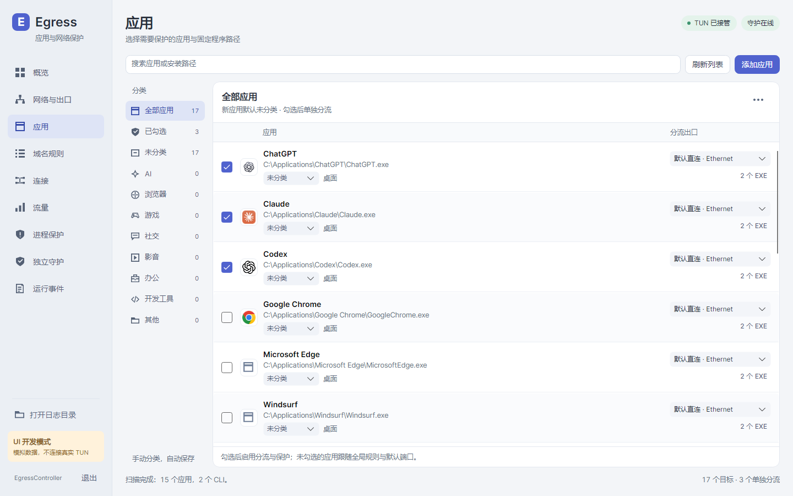
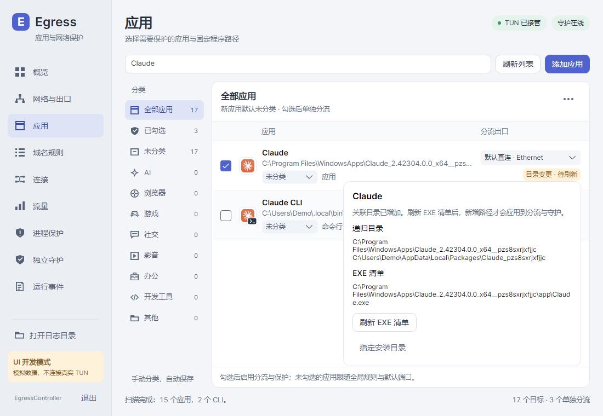
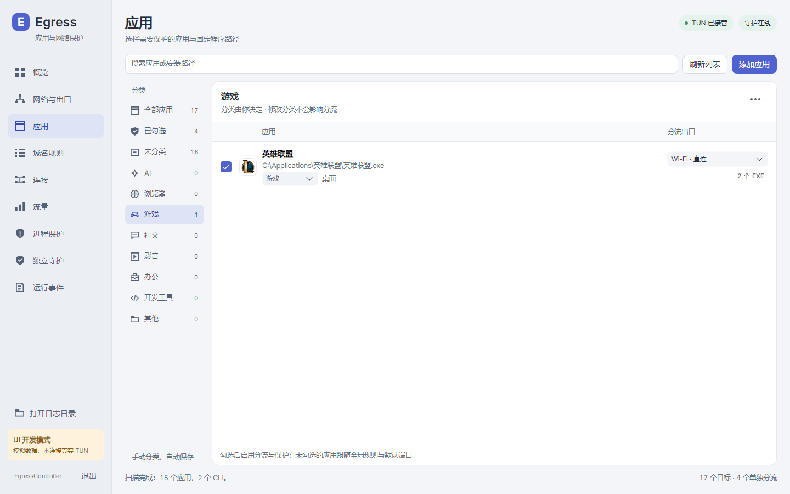
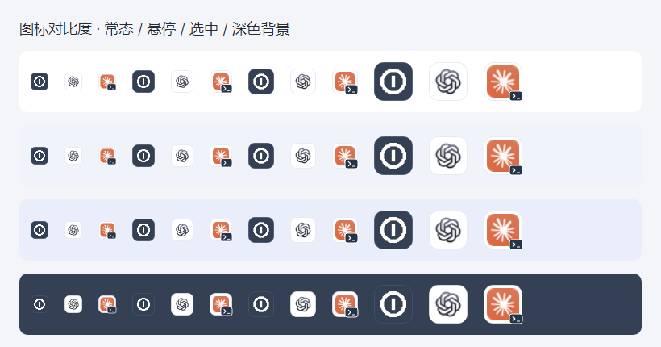

# Windows 应用与桌面界面

应用列表覆盖 Windows 已安装应用、游戏平台记录和原生 AI CLI，允许手动指定目录或 EXE。产品名称/图标识别使用主程序及包身份，不因目录中含有浏览器/Copilot 就改名。所有新应用默认未分类、未勾选；内置分类完全由用户选择，写入 SQLite。

Claude 桌面应用显示为一行，其 resources 下的 SSH 辅助 EXE 仍属于目录扫描后保存的固定清单。CLI 使用相同产品图标并显示 `Claude CLI` / `Codex CLI`，仅保护命令对应的独立 EXE。进程父子关系不参与判定。

MSIX 应用同时关联系统登记的安装/有效目录和当前用户的 `%LOCALAPPDATA%\Packages\<PackageFamilyName>`。家族标识来自 Windows 包身份（注册表兜底通过 `PackageFamilyNameFromFullName` 解析），不使用显示名称或版本前缀猜测；LocalAppData 通过未重定向的 Windows 已知文件夹接口读取。安装位置可在其他盘，版本目录变化也不会改变数据目录的关联。Claude 在该包数据目录中下载的 `claude-code\版本\哈希\claude.exe` 因而与桌面应用同属一个递归清单，无需写死 Claude 或运行时版本。

升级前的旧缓存保留原 EXE，但新增关联目录会使其显示“目录变更 · 待刷新”。在应用列表点击该提示，再点“刷新 EXE 清单”，才重新枚举两处目录并应用到既有出口/守护名单；界面可查看全部递归目录和已保存路径。元数据扫描不会自行扩大保护范围或重启 TUN。不存在的数据目录不创建；无法访问、链接越界等扫描失败保留原清单并显示原因。目录中新出现的 EXE 仍须显式刷新，不使用目录通配规则。独立 `.local\bin\claude.exe` 不属于该包，继续单独选择。

扫描器通过系统 Windows PowerShell 的 `Get-Command` 读取命令 Source，不执行用户配置文件或 AI 命令。已知 npm 包若包含专属原生 EXE，可以解析该路径；只有共享 Node/Python 脚本或无法解析的商店命令别名时，显示扫描提示，不把解释器整体作为 AI 应用保护。

旧的辅助项显示在所属应用中；不同出口保留并提示统一，只有用户明确操作才修改已保存的分流。元数据刷新和分类修改不会重启 TUN。重新选择出口保留以前保存的 EXE 路径；目录新增文件需要明确刷新清单。

安装来源优先读取系统注册表、MSI/MSIX 接口和游戏库元数据。Steam 读取 libraryfolders.vdf / appmanifest；腾讯游戏读取 InstallPath / setup 等安装登记。安装器与单个游戏各有独立目录。只有首次勾选或刷新 EXE 清单才递归枚举具体目录；不读取游戏资源内容、不爬整个 Program Files/游戏库、不跟随链接扩大范围。未能完整读取时显示失败，原清单保持。

连接与流量展示共用进程名称、产品图标缓存。Windows 图标资源在后台读取，缓存有上限，原生读取并发上限为 4；失败显示中性图标，不影响保护。网卡显示由运行时 GUID 解析为 Windows 接口名称，详细信息还显示设备描述，原始 adapter 标签不作为主标签。

共享 AppAvatar 根据原图像素选择浅色或深色圆角底板，解决白色/浅色透明图标在普通、悬停和选中背景上不可见的问题；不改品牌颜色或比例。CLI 在相同图标上使用统一的小标记。分类栏、应用行、选择器与菜单沿用共同字体、圆角、强调色和键盘焦点样式。

通知区使用公开 Win32 Shell API 注册图标、读取图标矩形和显示器工作区，再显示共享 Avalonia 菜单。菜单支持方向键、Esc、鼠标、禁用态和不同显示器 DPI；Explorer 重启会重新注册。测试只使用模拟矩形和无副作用窗口，不注册真实通知图标。

主程序和小托盘窗口均有退出入口；退出托盘不停止服务。通知图标无法创建时显示错误，窗口仍保留在任务栏可访问。

## 隔离预览

